<div align="center">


<a href="https://saket0187.github.io">
  
</a>

<a href="https://saket0187.github.io"></a>
<a href="https://www.linkedin.com/in/saket-kumar-mall/"></a>
<a href="mailto:saketmalltheofficial08@gmail.com"></a>
<a href="https://leetcode.com/u/Saket_Kumar_Mall/"></a>

</div>

<br/>

##  whoami

```console
saket@dev:~$ whoami
Saket Kumar Mall, software developer from India 🇮🇳

saket@dev:~$ cat now.txt
Pursuing an MCA at SRM IST (2026-28)
Contributing to open source projects
Open to SWE roles and internships
```

<div align="center">
<table>
  <tr>
    <td align="center" width="200"><h3>GSoC '26</h3><sub>GRASS, under NumFOCUS</sub></td>
    <td align="center" width="200"><h3>2000+</h3><sub>LeetCode contest rating</sub></td>
    <td align="center" width="200"><h3>1100+</h3><sub>problems solved</sub></td>
    <td align="center" width="200"><h3>#786</h3><sub>TCS CodeVita global rank</sub></td>
  </tr>
</table>
</div>

<br/>

##  Open Source

**GSoC 2026 at GRASS.** I brought space-time datasets into the GRASS GUI Data Catalog, so people can list, search and manage them without going to the command line. Mentored by Anna Petrasova and Stefan Blumentrath.

<a href="https://github.com/OSGeo/grass/pull/7608"></a>
<a href="https://saket0187.github.io/projects/grass-stds-datacatalog/"></a>
<a href="https://saket0187.github.io/gsoc-2026/"></a>
<a href="https://github.com/search?q=author%3Asaket0187+is%3Apr+is%3Amerged+-user%3Asaket0187&type=pullrequests"></a>

Some of the projects I've contributed to:

<!-- To add a project, copy one <td>...</td> block and change the org name, link and label. -->
<table>
  <tr>
    <td align="center" width="96"><a href="https://github.com/kubeedge/kubeedge/pulls?q=is%3Apr+author%3Asaket0187"><br/><sub><b>KubeEdge</b></sub></a></td>
    <td align="center" width="96"><a href="https://github.com/search?q=author%3Asaket0187+is%3Apr+org%3Abitcoindevkit&type=pullrequests"><br/><sub><b>BDK</b></sub></a></td>
    <td align="center" width="96"><a href="https://github.com/getAlby/hub/pulls?q=is%3Apr+author%3Asaket0187"><br/><sub><b>Alby Hub</b></sub></a></td>
    <td align="center" width="96"><a href="https://github.com/OSGeo/grass/pulls?q=is%3Apr+author%3Asaket0187"><br/><sub><b>GRASS</b></sub></a></td>
  </tr>
</table>

<br/>

##  Things I've Built

| Project | What it does | Stack |
|---|---|---|
| [**Recoup AI Agent**](https://github.com/saket0187/recoup-ai-agent) | Decides how to chase failed payments and overdue invoices, then measures itself against a randomised control group. No LLM inside. | TypeScript, Next.js, scikit-learn |
| [**ChronoFlow**](https://saket0187.github.io/projects/chronoflow/) | Meetings, deadlines and leave approvals with role-based access. Index tuning cut read latency by 30%. | Java, Spring Boot, MySQL |
| [**YouTube Sentiment**](https://github.com/saket0187/real-time-youtube-sentiment-analysis) | Serverless sentiment analysis of YouTube comments in English, Hindi and Hinglish, with Gemini summaries. | Python, GCP, Streamlit |
| [**ATS Resume Ranker**](https://github.com/saket0187/ATS-Resume-Screening-and-Ranking-System) | Ranks resumes against a job description using sentence embeddings. | Python, Streamlit |

<br/>

##  Toolbox

<table>
  <tr>
    <td align="right"><b>Languages</b></td>
    <td></td>
  </tr>
  <tr>
    <td align="right"><b>Backend &amp; web</b></td>
    <td></td>
  </tr>
  <tr>
    <td align="right"><b>Data</b></td>
    <td></td>
  </tr>
  <tr>
    <td align="right"><b>Machine learning</b></td>
    <td></td>
  </tr>
  <tr>
    <td align="right"><b>Cloud &amp; tooling</b></td>
    <td></td>
  </tr>
</table>

<br/>

##  GitHub Stats

<div align="center">
  
  
  <br/><br/>
  
  <a href="https://leetcode.com/u/Saket_Kumar_Mall/">
    <picture>
      <source media="(prefers-color-scheme: dark)" srcset="https://leetcard.jacoblin.cool/Saket_Kumar_Mall?theme=dark&border=0&radius=10"/>
      <source media="(prefers-color-scheme: light)" srcset="https://leetcard.jacoblin.cool/Saket_Kumar_Mall?theme=light&border=0&radius=10"/>
      
    </picture>
  </a>
  <br/><br/>
  
  <br/><br/>
  <picture>
    <source media="(prefers-color-scheme: dark)" srcset="https://raw.githubusercontent.com/saket0187/saket0187/output/github-snake-dark.svg"/>
    <source media="(prefers-color-scheme: light)" srcset="https://raw.githubusercontent.com/saket0187/saket0187/output/github-snake.svg"/>
    
  </picture>
</div>

<br/>

##  Let's Talk

Hiring, or want to talk about one of my PRs? [Email me](mailto:saketmalltheofficial08@gmail.com), I'm always happy to chat.

<div align="center">
  <br/>
  
  
</div>
